# Aerial2Ground — Cross-View Scene Layout & Synthesis

<p align="center">
  <b>From a satellite tile alone: predict ground-level semantics and synthesise a street panorama.</b>
</p>

### Stage 1 — best layout head (`polar_full`, **0.514 mIoU** @ 8884)

<p align="center">
  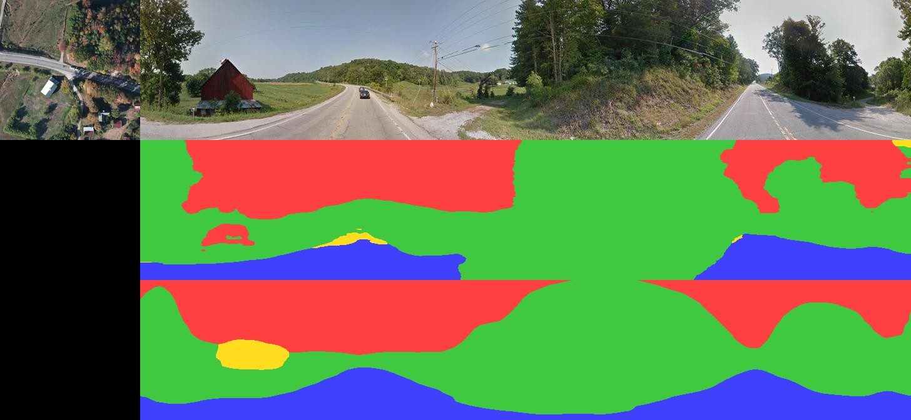
</p>
<p align="center"><sub>Aerial · street pano · SegFormer GT map · <b>predicted</b> map (DINOv2 + column decoder, 1.5M params)</sub></p>

### Stage 2 — best GAN (**SPADE + aerial**, **FID<sub>clean</sub> 141.0** oracle / legacy Inception **116.2**, `G_step0032000`)

<p align="center">
  
</p>
<p align="center"><sub>GT layout · real CVUSA pano · <b>generated</b> pano (lowest-FID Stage-2 checkpoint, val montage)</sub></p>

### End-to-end pipeline (**Config E** — predicted layout + SPADE + aerial)

<p align="center">
  
</p>
<p align="center"><sub>CVUSA val row 500 · <code>pipeline.py</code> · no GT layout at inference</sub></p>

<p align="center">
  <a href="#headline-results">Results</a> ·
  <a href="#architecture">Architecture</a> ·
  <a href="#research-arc">Research arc</a> ·
  <a href="#visual-results--live-demo-outputs">Demos</a> ·
  <a href="#quickstart">Quickstart</a> ·
  <a href="#reproduce-metrics">Reproduce eval</a> ·
  <a href="experiments/RESEARCH_HANDOFF.md">Paper handoff</a> ·
  <a href="experiments/results_table.json">Locked numbers (JSON)</a>
</p>

---

**Aerial2Ground** predicts ground-level semantic layout from a satellite tile (**PolarLayoutNet** on frozen DINOv2, **0.514 mIoU** on CVUSA) and synthesises a street panorama (**SPADE + warped aerial**). Built on a PyTorch reimplementation of Zhai et al. (CVPR 2017) [[paper]](http://openaccess.thecvf.com/content_cvpr_2017/papers/Zhai_Predicting_Ground-Level_Scene_CVPR_2017_paper.pdf), extended with SegFormer **v2** labels, ablations, and a **clean-FID** eval ladder (**141.0** oracle · **182.1** end-to-end, n=8884). Early **CrossNet + Pix2Pix** baselines remain under `legacy/` and `experiments/phase1/`.

**Status (2026):** training and full validation eval **complete**. Headline synthesis metrics use **clean-FID** (n=8884): **Config D** oracle **141.0**, **Config E** end-to-end **182.1**. Checkpoints: **[GitHub release v1.0.0](https://github.com/anasahmed81103/AerialToGround/releases/tag/v1.0.0)** + Zenodo DOI (see [Reproducibility](#reproducibility--release-v100)).

---

## Table of contents

- [Headline results](#headline-results)
- [Models chosen for reporting](#models-chosen-for-reporting)
- [Research arc](#research-arc)
- [Architecture](#architecture)
- [Stage 1 — layout prediction](#stage-1--layout-prediction)
- [Stage 1 ablations (full matrix)](#stage-1-ablations-full-matrix)
- [Stage 2 — layout → RGB (training protocol)](#stage-2--layout--rgb-training-protocol)
- [Stage 2 ablations & checkpoint selection](#stage-2-ablations--checkpoint-selection)
- [Stage 2 results — oracle layouts (GT)](#stage-2-results--oracle-layouts-gt)
- [Final publication eval — ladder A→E](#final-publication-eval--ladder-ae)
- [Oracle vs evaluated (E2E) — side by side](#oracle-vs-evaluated-e2e--side-by-side)
- [Visual results & live demo outputs](#visual-results--live-demo-outputs)
- [Engineering & compute](#engineering--compute)
- [Quickstart](#quickstart)
- [Reproduce metrics](#reproduce-metrics)
- [Dataset & labels](#dataset--labels)
- [Training](#training)
- [Repository layout](#repository-layout)
- [Phase 1 & baseline (CrossNet)](#phase-1--baseline-crossnet)
- [Limitations & how to cite numbers](#limitations--how-to-cite-numbers)
- [Literature context](#literature-context)
- [Deployment & demos](#deployment--demos)
- [Reproducibility & release v1.0.0](#reproducibility--release-v100)
- [Citation & license](#citation--license)

---

## Headline results

All layout metrics: **full test set** n=**8884**, `cvpr_val_v2.csv`, 4 classes (sky · vegetation · road · building), upsampled to **224×1232** for mIoU unless noted.

| Stage | Best model | Key metric (clean-FID unless noted) | Notes |
|-------|------------|-------------------------------------|--------|
| **Stage 1** | **PolarLayoutNet** `polar_full` | **mIoU 0.514** @ 8884 | +0.215 vs fair CrossNet on v2 (0.299) |
| **Stage 2 oracle** | **Config D** SPADE + aerial, GT layout | **FID<sub>clean</sub> 141.0** | Upper-bound synthesis; same ckpt as E |
| **End-to-end** | **Config E** pred layout + SPADE + aerial | **FID<sub>clean</sub> 182.1** | **+41 FID** vs D (layout error) |

<sup>Legacy val FID (torchvision Inception, GT layout): Pix2Pix 157.6 → SPADE 129.7 → SPADE+aerial **116.2** — do not compare directly to clean-FID columns above.</sup>

<details>
<summary><b>Config E synthesis metrics (n=8884, clean-FID harness)</b></summary>

| SSIM ↑ | PSNR ↑ | LPIPS ↓ | FID<sub>clean</sub> ↓ | KID ↓ |
|--------|--------|---------|------------------------|-------|
| 0.459 | 14.82 | 0.650 | **182.1** | 0.209 |

Source: `experiments/final_eval/` (full run); summary in [`experiments/results_table.json`](experiments/results_table.json) → `final_eval_publication`.
</details>

---

## Models chosen for reporting

These are the **locked** checkpoints used in `pipeline.py`, `final_eval.py`, and the paper-facing tables (weights are local — see [`experiments/phase2/MODELS.txt`](experiments/phase2/MODELS.txt)).

| Role | Run name | Checkpoint | Why this one |
|------|----------|------------|--------------|
| **Stage 1 (E2E layout)** | `polar_full` | `experiments/phase2/runs/polar_full/best.pt` | Best test mIoU **0.514**; beats all ablations except ~ties within ±0.001 |
| **Stage 2 (E2E RGB)** | `spade_aerial_v2` | `G_step0032000.pt` | Best **legacy** val FID **116.2** with GT layout; used with **pred** layout in Config **E** |
| Stage 2 ablation (layout-only SPADE) | `spade_v2` | `G_step0033300.pt` | FID **129.7** — isolates value of aerial aux vs `spade_aerial_v2` |
| Stage 2 Pix2Pix baseline | `gan_v2_random_d` | `G_step0231066.pt` | Best Pix2Pix on v2 (**157.6** FID); **random_init_d** fix vs failed warm-D retrain |
| Legacy Stage 1 compare | Phase 1 CrossNet | `experiments/phase1/checkpoints/crossnet_best.pt` | Fair v2-label CrossNet (**0.402** mIoU) |
| Legacy baseline | CrossNet 88830 | `experiments/baseline/checkpoints/crossnet_step0088830.pt` | Zhai reimplementation (**0.299** mIoU on v2) |

**Not selected:** `polar_full_classweighted` (trades −0.013 mIoU for +building IoU), `polar_full_64x320` (no gain vs 32×160), `gan_v2_retrain` (D saturated, FID 164.4), prior/offset ablations (null effect).

---

## Research arc

```
Baseline (Zhai CrossNet, old labels)
    │  mIoU 0.454 @ 8884 — not comparable to v2
    ▼
Phase 1 — same CrossNet, SegFormer v2 labels + focal/dice + 32×160
    │  mIoU 0.402 @ 8884 (+0.10 vs old ckpt on v2)
    ▼
Phase 2 Stage 1 — frozen DINOv2 + full tile + PolarLayoutNet (~1.5M params)
    │  mIoU 0.514 @ 8884
    ▼
Phase 2 Stage 2 — SPADE / Pix2Pix on GT layouts; best SPADE+aerial FID 116.2
    │  Trained with oracle maps; E2E uses predicted layout at test
    ▼
Final eval — configs A→E, clean-FID, bootstrap CIs (2026, DONE)
```

| Phase | What changed | Outcome |
|-------|----------------|---------|
| **Baseline** | VGG CrossNet, 8×40 grid, original CVUSA SegNet-style labels | Strong sky/road; **vegetation IoU ~0.09** on old labels |
| **Phase 1** | SegFormer pseudo-labels (`labels_v2/`), 32×160 head, focal+dice, flip | **Fair** gain on v2: 0.299 → **0.402** mIoU; vegetation IoU **0.53** |
| **Phase 2 S1** | Cached DINOv2-S/14, 750px tile, polar column decoder | **0.514** mIoU, **~234 min** on 4 GB GPU, **1.98 GB** peak VRAM |
| **Phase 2 S2** | SPADE + λ_L1=10 + VGG perceptual; optional **warped aerial** aux | GT-layout FID ladder **157.6 → 129.7 → 116.2** |
| **Final eval** | Predicted vs GT layout; Pix2Pix vs SPADE; aerial on/off | **E** vs **D** quantifies layout bottleneck; paired CIs for aerial aux |

Deep narrative for writing: **[`experiments/RESEARCH_HANDOFF.md`](experiments/RESEARCH_HANDOFF.md)**.

---

## Architecture

End-to-end system (**Config E**): one aerial tile in → layout + warped nadir RGB + synthesised street panorama out. Training is **two-stage** (layout head, then GAN); metrics use either **oracle** GT layouts (A–D) or **predicted** layouts (C, E).

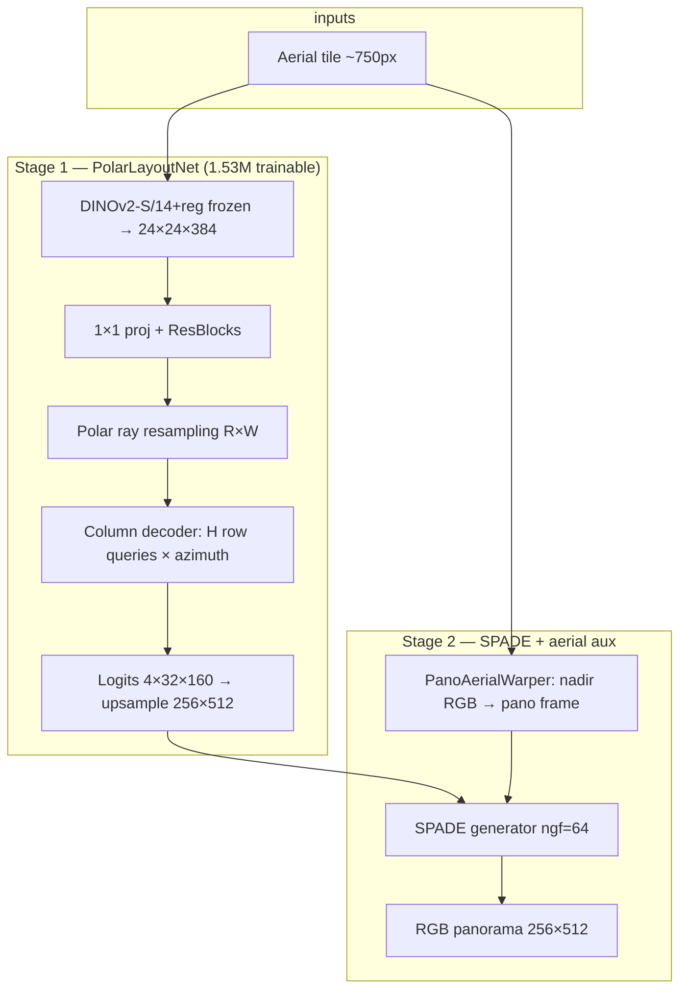

### Stage 1 — PolarLayoutNet (`polar_layout_model.py`)

| Step | Tensor shape (typical) | Detail |
|------|------------------------|--------|
| Input tile | 750×750 RGB → **336×336** | Full tile (not 224 center crop); ImageNet norm |
| DINOv2-S/14+reg | **(384, 24, 24)** | Frozen; cached to `cache/dinov2s_reg_336/{train,val}.npy` for training |
| Backbone adapter | **(D, 24, 24)** | 1×1 conv + 2× ResBlock (GroupNorm) |
| Polar sampling | **(D, R, W)** | R radial bins along rays; W azimuth columns; optional learned offsets |
| Column decoder | **(D, H, W)** | **H=32** row queries attend over R samples **per column**; weights **shared** across azimuth → rotation-equivariant, **no** dense 289×320 matrix |
| Segmentation head | **(4, 32, 160)** | Circular padding on W; focal(γ=2) + dice at train |
| Inference upsample | **(4, 256, 512)** | Bilinear `align_corners=True` → argmax → colour layout |

**CVUSA geometry** (`geo_calibrate.py`): north at **centre column**, azimuth **clockwise**, panorama **bottom row ≈ camera / tile centre**, horizon near mid-height. Ground-plane attention prior (optional) did **not** change metrics in ablations.

**Ablations:** `mapping='dense'` swaps polar sampling for a learned **g×g → R×W** matrix (CrossNet-style) — ~same mIoU at **3× params**.

### Stage 2 — SPADE + warped aerial (`spade_model.py`, `aerial_warp.py`)

| Piece | Detail |
|-------|--------|
| Layout conditioning | 4-class one-hot in **[-1, 1]**, **256×512** (from GT at train; from Stage 1 at E2E) |
| Aerial auxiliary | Original Bing tile warped into panorama coordinates via **`PanoAerialWarper`**; concatenated as extra SPADE conditioning channels |
| Generator | **SPADE** ResNet blocks (Park et al. 2019); semantic map modulates norm at **every** scale |
| Discriminator | **70×70 PatchGAN**, LSGAN |
| Losses | λ_L1=**10**, λ_VGG perceptual=**10** (SPADE); Pix2Pix baseline uses λ_L1=**100**, no perceptual |
| Train protocol | **GT layouts** from `labels_v2/ground/` + real panos; **8884** val for FID/SSIM selection |

**Pix2Pix U-Net** (`gan_unet_model.py`) remains the Stage 2 **baseline** (Config **A**); generator warm-started from v1 `G_step0197766.pt`, but **D must be re-initialized** on v2 (`--random_init_d`).

### Baseline & Phase 1 architecture (historical)

Zhai **CrossNet**: VGG-16 VALID hypercolumn → networks A, S, F → soft transfer matrix **M** → native **8×40** (Phase 1: **32×160**) layout. Phase 2 **replaces** Stage 1 entirely; Phase 1 numbers remain as **fair CrossNet** comparisons on v2 labels.

<details>
<summary><b>CrossNet data flow (CVPR 2017 reimplementation)</b></summary>

```
Aerial 224×224
  → VGG-16 blocks 1–4 (VALID) → hypercolumn 960-ch @ 17×17
  → Network A: hypercolumn → La (17×17, C)
  → Network S: conv4_3 → conditioning scalar S per pixel
  → Network F: (i,j,y,x,S) → M (289×320)
  → Lg = Mᵀ La + bias → (C, 8, 40) → upsample → GAN
```

</details>

### Code map

| Component | File(s) |
|-----------|---------|
| DINO cache / live | `cache_dino_features.py` |
| Stage 1 train/eval | `train_polar.py`, `phase2_weighted_loss.py` |
| Stage 2 train/eval | `train_gan_pix2pix.py`, `eval_gan_pix2pix.py`, `gan_perceptual_loss.py` |
| Layout codec (eval) | `gan_layout_codec.py` |
| **E2E** | **`pipeline.py`**, `app.py` |
| **Publication eval** | `final_eval.py`, `bootstrap_ci.py`, `gan_metrics.py` |

Checkpoints: [`experiments/phase2/MODELS.txt`](experiments/phase2/MODELS.txt).

---

## Stage 1 — layout prediction

**Protocol:** select best epoch on a **2,000-image minival** carved from train (seed 0); report on **full 8884 test** — never tune on test.

### Fair comparison on v2 labels (full val)

| Model | mIoU | Sky IoU | Veg IoU | Road IoU | Bldg IoU | Pix acc |
|-------|------|---------|---------|----------|----------|---------|
| Baseline CrossNet (88830 ckpt) | 0.299 | 0.638 | 0.026 | 0.438 | 0.095 | 0.434 |
| Phase 1 CrossNet (best) | 0.402 | 0.633 | 0.533 | 0.362 | 0.080 | 0.665 |
| **PolarLayoutNet `polar_full`** | **0.514** | **0.689** | **0.661** | **0.494** | **0.209** | **0.745** |

**Training (`polar_full`):** 8 epochs, batch 16, focal(γ=2)+dice, horizontal flip, **1,533,702** trainable params, **~234 min** on Quadro P1000 4 GB.

**Do not compare** baseline **0.454** mIoU (old SegNet labels) to **0.514** (v2 labels) in one column without relabeling.

---

## Stage 1 ablations (full matrix)

All rows: **full val n=8884**, v2 labels, eval upsample to **224×1232** mIoU. Reference: **`polar_full`** (selected for paper + E2E).

### Round 1 — decoder mechanisms (null results)

| Run | mIoU | Sky | Veg | Road | Bldg | vs `polar_full` |
|-----|------|-----|-----|------|------|-----------------|
| **`polar_full`** ✓ | **0.514** | 0.689 | 0.661 | 0.494 | 0.209 | — |
| `polar_prior_none` | 0.514 | 0.690 | 0.662 | 0.494 | 0.209 | +0.000 |
| `polar_prior_fixed` | 0.513 | 0.688 | 0.660 | 0.495 | 0.210 | −0.001 |
| `polar_no_offsets` | 0.514 | 0.691 | 0.663 | 0.497 | 0.206 | +0.001 |

**Conclusion:** ground-plane prior and radial offsets **not retained** in the main claim.

### Round 2 — where mIoU comes from

| Run | mIoU | Params (trainable) | Single change |
|-----|------|-------------------|---------------|
| **`polar_full`** ✓ | **0.514** | **1.53M** | DINOv2 + full 750px tile + polar column decoder |
| `polar_dense_mapping` | 0.514 | 4.48M | Learned dense cross-view matrix instead of polar rays |
| `polar_crop224` | 0.502 | 1.53M | 224px center crop (~9% of tile) instead of full tile |
| `polar_vgg16` | 0.485 | 1.53M | Frozen ImageNet VGG-16 relu5_3 instead of DINOv2 |

**Conclusion:** **DINOv2 (~+0.029)** and **full tile (~+0.012)** drive gains; polar vs dense **~tie**.

### Round 3 — head resolution & class weights

| Run | Native grid | mIoU | Bldg IoU | Selected? |
|-----|-------------|------|----------|-----------|
| **`polar_full`** ✓ | 32×160 | **0.514** | 0.209 | **Yes** — best overall |
| `polar_full_64x320` | 64×320 | 0.513 | 0.214 | No — no mIoU gain at full-res eval |
| `polar_full_classweighted` | 32×160 | 0.501 | 0.237 | No — −0.013 mIoU for +0.028 building |

### Phase 1 label & training ablations (CrossNet, same architecture family)

| Change (Phase 1) | Effect on fair v2 compare (n=1024 / 8884) |
|------------------|-------------------------------------------|
| SegFormer v2 pseudo-labels vs old SegNet maps | Baseline ckpt **0.299 → 0.403** mIoU; **veg IoU 0.03 → 0.53** |
| 32×160 grid + focal + dice + flip vs 8×40 soft CE | Finer layout + better rare classes |
| Aerial auxiliary loss (0.5) | Used in Phase 1; **dropped in Phase 2** (nadir ADE labels misaligned) |
| Fresh VGG init vs resume collapsed 88830 | Stable Phase 1 training |

**Paper-facing Stage 1 claim:** frozen **DINOv2** + **full-tile** context + **shared column decoder** @ **1.5M** params — not polar prior/offsets.

---

## Stage 2 — layout → RGB (training protocol)

- **Train** generators on **ground-truth** semantic maps from `labels_v2/ground/` + real panos (`cvpr_train_v2.csv`).
- **Resolution:** RGB **256×512**; layouts as 4-channel one-hot in **[-1, 1]**.
- **At test / E2E:** plug in **Stage-1 predicted** layouts (Configs **C**, **E**).
- **Pix2Pix** warm-starts from v1 `G_step0197766.pt`; **SPADE trains from scratch**.
- **Critical fix:** `--random_init_d` when fine-tuning on v2 — warm-started D **saturated** (D≈0, G_adv≈1); see diagnostic runs `gan_v2_diag*`.

| Generator | Conditioning | λ_L1 | Other losses |
|-----------|--------------|------|----------------|
| U-Net Pix2Pix | Layout only | 100 | LSGAN |
| SPADE | Layout | 10 | + VGG perceptual 10 |
| **SPADE + `--aux_aerial`** | Layout + **warped aerial RGB** | 10 | + perceptual 10 |

---

## Stage 2 ablations & checkpoint selection

All trained on **GT v2 layouts**; metrics on **8884** val unless noted.

### Pix2Pix — discriminator initialization (critical fix)

| Run | D init | Val FID ↓ | SSIM | LPIPS ↓ | Outcome |
|-----|--------|-----------|------|---------|---------|
| `gan_v2_retrain` | Warm-start D from v1 | **164.4** | 0.516 | 0.618 | D **saturated** (D≈0, G_adv≈1); L1-dominated |
| **`gan_v2_random_d`** ✓ | **Random D**, G from v1 | **157.6** | 0.516 | 0.610 | **Selected** Pix2Pix baseline (Config **A** ckpt family) |

Diagnostics: `experiments/phase2/runs/gan_v2_diag*` — documented in `logs/gan_v2_diag3.txt`.

### SPADE — architecture & conditioning ladder (oracle layout)

| Run | Generator | Aerial aux | Step | FID ↓ (legacy) | LPIPS ↓ | Selected? |
|-----|-----------|------------|------|----------------|---------|-----------|
| `gan_v2_random_d` | U-Net Pix2Pix | No | 231066 | 157.6 | 0.610 | Baseline **A** |
| `spade_v2` | SPADE | No | 33300 | **129.7** | 0.591 | Config **B** family |
| **`spade_aerial_v2`** ✓ | SPADE | **Yes** | **32000** | **116.2** | **0.565** | **Best oracle FID**; Config **D** / **E** generator |

**Training notes:** SPADE trained **from scratch** (no G warm-start). Late epochs often **D_weak** — checkpoint chosen by **val FID**, not last step. `spade_aerial_v2`: 15 epochs, resumed @ step 12000, best save @ **32000**.

---

## Stage 2 results — oracle layouts (GT)

**Harness:** `eval_gan_pix2pix.py` · n=**8884** · **GT** v2 layouts · FID = **torchvision Inception pool3** (legacy — not clean-FID).

| Model | Checkpoint step | SSIM ↑ | LPIPS ↓ | FID ↓ |
|-------|-----------------|--------|---------|-------|
| Pix2Pix `gan_v2_random_d` | 231066 | 0.516 | 0.610 | 157.6 |
| Pix2Pix `gan_v2_retrain` (warm D) | 231066 | 0.516 | 0.618 | 164.4 |
| SPADE `spade_v2` | 33300 | 0.507 | 0.591 | **129.7** |
| **SPADE + aerial `spade_aerial_v2`** | **32000** | **0.509** | **0.565** | **116.2** |

**SPADE notes:** pick checkpoint by **val FID**, not last step; late training often **L1 + perceptual dominated** when D weakens. **Warped aerial** consistently improves LPIPS/FID on GT layouts.

---

## Final publication eval — ladder A→E

**Harness:** `final_eval.py` · n=**8884** · **FID/KID = clean-fid** (mode=`clean`) · SSIM, PSNR, LPIPS (alex), SD (Laplacian sharpness diff) · `bootstrap_ci.py` (1000 images, seed 0).

Predicted layouts: `polar_full/best.pt` on cached val DINO → logits **(4, 32, 160)** → bilinear upsample **256×512** → argmax → `gan_layout_codec` one-hot.

| Config | Layout | Generator | Aerial aux | SSIM | PSNR | LPIPS ↓ | FID<sub>clean</sub> ↓ | KID ↓ |
|--------|--------|-----------|------------|------|------|---------|----------------------|-------|
| **E** | **Predicted** | SPADE | **Yes** | **0.459** | **14.82** | **0.650** | **182.1** | 0.209 |
| C | Predicted | SPADE | No | 0.458 | 14.65 | 0.671 | 195.0 | 0.221 |
| **D** | **GT (oracle)** | SPADE | **Yes** | **0.509** | **17.28** | **0.565** | **141.0** | 0.163 |
| B | GT | SPADE | No | 0.507 | 17.06 | 0.591 | 155.4 | 0.179 |
| A | GT | Pix2Pix U-Net | No | 0.516 | 17.07 | 0.610 | 167.4 | 0.180 |

**Paired bootstrap (95% CI excludes 0):**

| Comparison | Effect |
|------------|--------|
| **E − C** (aerial on **predicted** layout) | LPIPS **−0.021**; aerial helps even with noisy layout |
| **D − B** (aerial on **GT** layout) | LPIPS **−0.026**; FID **141 vs 155** |

Re-run: `experiments/phase2/code/run_final_eval_full.sh` (GPU ~6 h on 4090). Artifacts: `experiments/final_eval/*_metrics.json`, sample PNG folders, `bootstrap_ci.json`.

---

## Oracle vs evaluated (E2E) — side by side

Two different questions:

1. **Oracle (GT layout):** “How good is synthesis **if** segmentation were perfect?” → Configs **A–D**, SSIM often **~0.51**, best clean-FID **141.0** (Config **D**).
2. **Evaluated / E2E (predicted layout):** “What does the **shipped pipeline** achieve?” → Configs **C**, **E** using **`polar_full/best.pt`** layouts.

**Stage 1 layout quality (same val split):** GT semantic mIoU upper bound = **1.0** (by definition for GT layouts in B/D/A); **predicted** layouts from `polar_full` reach **0.514 mIoU** vs GT maps — that gap drives most of the **D → E** synthesis FID gap.

### Publication metrics (same harness, n=8884, clean-FID)

| Config | Layout source | Generator | Aerial | SSIM↑ | PSNR↑ | LPIPS↓ | FID<sub>clean</sub>↓ | Role |
|--------|---------------|-----------|--------|-------|-------|--------|----------------------|------|
| A | **GT oracle** | Pix2Pix | No | 0.516 | 17.07 | 0.610 | 167.4 | Stage 2 architecture floor |
| B | **GT oracle** | SPADE | No | 0.507 | 17.06 | 0.591 | 155.4 | SPADE without aerial |
| D | **GT oracle** | SPADE | **Yes** | **0.509** | **17.28** | **0.565** | **141.0** | **Best oracle** (upper bound) |
| C | **Predicted** | SPADE | No | 0.458 | 14.65 | 0.671 | 195.0 | E2E without aerial |
| **E** | **Predicted** | SPADE | **Yes** | **0.459** | **14.82** | **0.650** | **182.1** | **Headline E2E** |

**Gaps (clean-FID):**

| Comparison | Δ FID | Interpretation |
|------------|-------|----------------|
| **E vs D** (E2E vs oracle, same SPADE+aerial) | **141.0 → 182.1 (+41 on E)** | Layout prediction error dominates photorealism |
| **C → E** (add aerial aux, **predicted** layout) | **195.0 → 182.1 (−13)**; LPIPS **−0.021** (bootstrap) | Warped aerial helps on **pred** layouts |
| **B → D** (add aerial aux, **GT** layout) | **155.4 → 141.0 (−14)**; LPIPS **−0.026** | Aerial aux under oracle |
| **B vs C** (oracle vs **predicted** layout, no aerial) | 155.4 vs 195.0 | Layout quality only (not an aerial on/off pair) |
| **A → B** (Pix2Pix → SPADE, GT layout) | 167.4 → 155.4 | SPADE wins under oracle |

### Legacy vs clean-FID (same models, different FID code)

| Config D model | Harness | FID |
|----------------|---------|-----|
| `spade_aerial_v2` @ 32000 | `eval_gan_pix2pix.py` (Inception pool3) | **116.2** |
| Same ckpt, GT layout | `final_eval.py` (clean-fid) | **141.0** |

Always label the FID column in tables — **do not merge 116.2 and 141.0** without a footnote.

Configs **A/B/D** use **oracle** pano segmentation → **SSIM ~0.51** is **not** comparable to literature E2E SSIM ~0.37 without disclosure. For cross-paper comparison, lead with **Config E**.

---

## Visual results & live demo outputs

The **top of this README** is a short teaser (one best example per stage). Below is a **full gallery** — Phase 1 baseline, Phase 2 layout/GAN training dumps, and live `pipeline.py` runs. Curated files: [`assets/gallery/`](assets/gallery/README.md). Publication **metrics** (Config A–E) live in [`experiments/final_eval/`](experiments/final_eval/) as JSON/NPZ — no montage figures here.

---

### Phase 1 — CrossNet + v1 Pix2Pix (baseline semester)

Five-sample grid: aerial → CrossNet semantic map → Pix2Pix panorama → CVUSA ground truth.

<p align="center">
  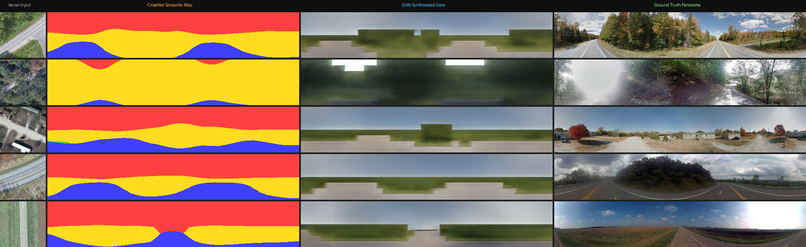
</p>

| Colour | Class |
|--------|-------|
| Red | Sky |
| Green | Vegetation |
| Blue | Road |
| Yellow | Building |

Pix2Pix training progression (v1 labels; generator later warm-starts Phase 2 Pix2Pix):

<p align="center">
  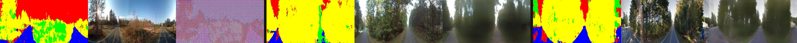
</p>

<p align="center"><sub>Step 1 → ~100k → ~197k steps (<code>G_step0197766</code>).</sub></p>

---

### Phase 2 — Stage 1 layout (`polar_full`, test showcases)

Each panel grid: **aerial · GT street pano · GT SegFormer map · predicted map** (full val test indices 0–7).

<p align="center">
  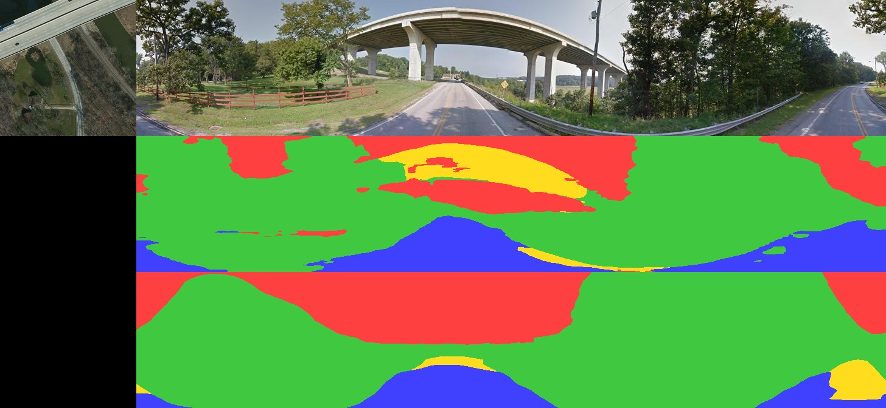
  &nbsp;
  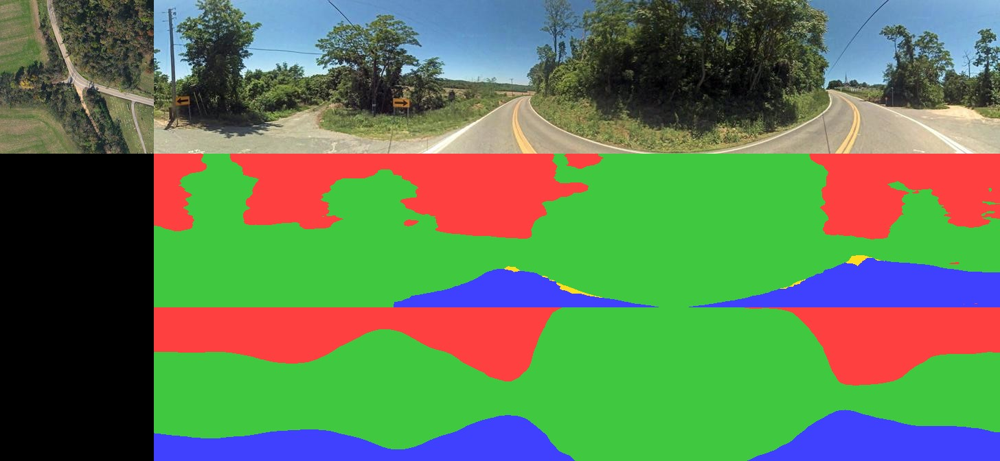
</p>
<p align="center">
  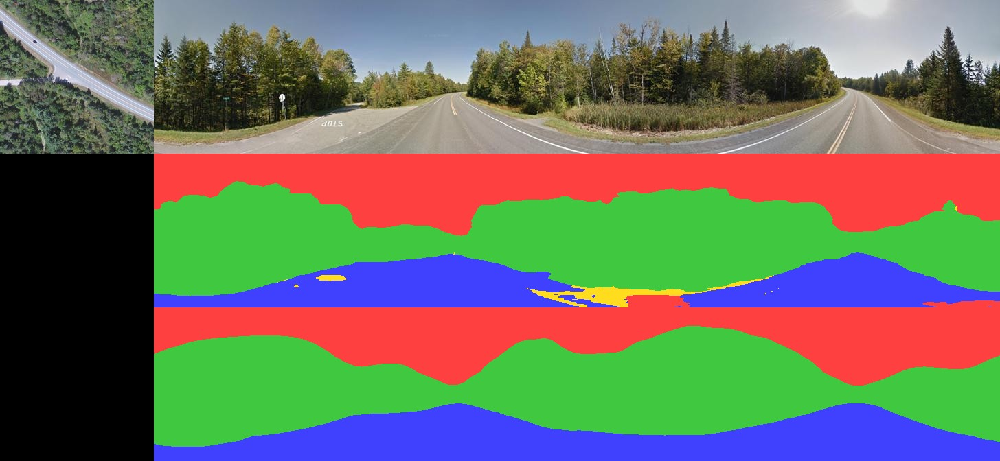
  &nbsp;
  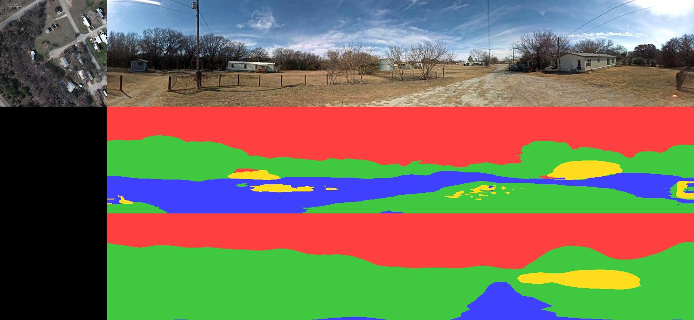
</p>

<p align="center"><sub>From <code>experiments/phase2/runs/polar_full/showcase/</code> @ <b>0.514 mIoU</b>.</sub></p>

---

### Phase 2 — Stage 2 synthesis (GT layout training dumps)

Side-by-side montages from validation: **semantic map · real pano · generated pano** (checkpoints chosen by **lowest val FID**).

| Model | FID (legacy val) | Gallery |
|-------|------------------|---------|
| Pix2Pix `gan_v2_random_d` | 157.6 | below |
| SPADE `spade_v2` | 129.7 | below |
| **SPADE + aerial** `spade_aerial_v2` | **116.2** | below |

<p align="center">
  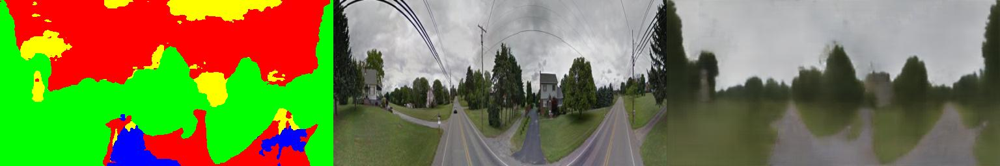
  &nbsp;
  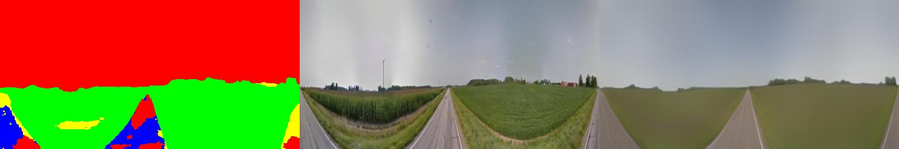
  &nbsp;
  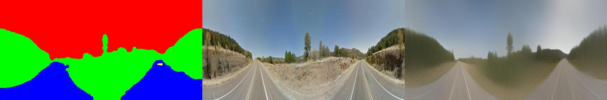
</p>

<p align="center"><sub>Oracle layouts at train time; same G checkpoints as Configs A/B/D/E.</sub></p>

---

### Phase 2 — End-to-end `pipeline.py` (predicted layout + SPADE + aerial)

**Aerial · generated · ground truth** — no GT layout fed to the network.

<p align="center">
  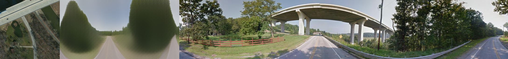
  &nbsp;
  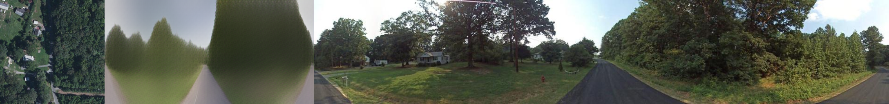
</p>
<p align="center">
  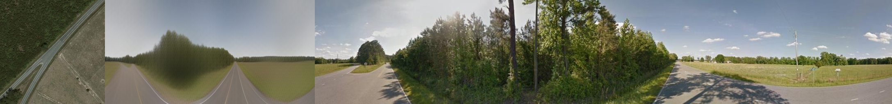
  &nbsp;
  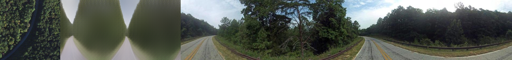
</p>
<p align="center">
  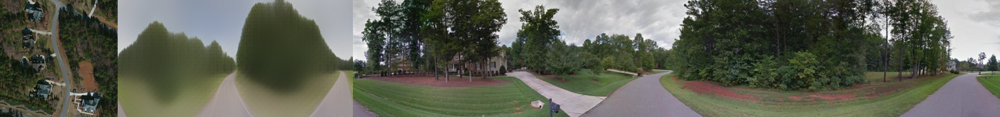
</p>

Full intermediate strip (val **500**): aerial · layout · warp · pano.

<p align="center">
  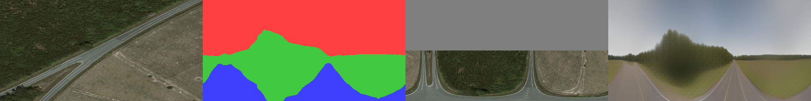
</p>

```bash
python pipeline.py --aerial test_pipeline_inputs/aerial_00500.jpg --out outputs/dataset_pipeline_test/idx_00500
```

---

## Engineering & compute

| Item | Detail |
|------|--------|
| Framework | PyTorch 2.x, AMP on Stage 2 / optional Stage 1 |
| Stage 1 train | **P1000 4 GB**, ~4 h, **$0** cloud |
| Stage 2 train | RunPod **RTX 4090**; checkpoint hygiene (rolling ckpts, weights-only saves) |
| Final eval | **4090**, ~**6 h** all configs + bootstrap |
| E2E inference | `pipeline.py` — live DINO + two `.pt` files; parity: `tests/test_pipeline_parity.py` |
| Demo | `app.py` (Gradio), `requirements_demo.txt` |
| Locked metrics | [`experiments/results_table.json`](experiments/results_table.json) |

---

## Quickstart

```bash
git clone https://github.com/anasahmed81103/AerialToGround.git
cd AerialToGround
pip install -r requirements.txt
pip install -r requirements_demo.txt
# GPU: install CUDA PyTorch from https://pytorch.org
```

Download or place checkpoints per [`experiments/phase2/MODELS.txt`](experiments/phase2/MODELS.txt), then:

```bash
python pipeline.py --aerial demo/sample_aerial_road.jpg --out outputs/demo_run/
# → montage.png (aerial | layout | warp | panorama)

python tests/test_pipeline_parity.py   # optional: match training cache / final_eval samples
python app.py                          # Gradio UI
```

Legacy CrossNet webcam demo: [`legacy/phase1_v1/README.md`](legacy/phase1_v1/README.md).

---

## Reproduce metrics

```bash
# Stage 1 mIoU (example)
python train_polar.py --name polar_full --cache cache/dinov2s_reg_336 --eval_only ...

# Stage 2 GT-layout FID (legacy harness)
python eval_gan_pix2pix.py --gan_ckpt experiments/phase2/runs/spade_aerial_v2/ckpts/G_step0032000.pt ...

# Publication ladder (GPU, full val)
bash experiments/phase2/code/run_final_eval_smoke.sh   # 64 images first
bash experiments/phase2/code/run_final_eval_full.sh    # 8884 + bootstrap
```

Full metric definitions and caveats: [`experiments/RESEARCH_HANDOFF.md`](experiments/RESEARCH_HANDOFF.md) §4.3.

---

## Dataset & labels

**CVUSA** — geo-registered aerial / ground panorama pairs.

| Asset | Path |
|-------|------|
| Train / val lists | `cvpr_train_v2.csv`, `cvpr_val_v2.csv` (8884 val) |
| v2 semantic PNGs | `cvpr_subset/labels_v2/{ground,aerial}/` |
| Relabel script | `scripts/relabel_cvusa.py` (SegFormer-B0 ADE, ~132 min, 44,416 pairs) |
| Demo tiles | `demo/` |

Subset imagery: `cvpr_subset/` (gitignored locally if large). Full CVUSA (~500 GB): [official request page](https://mvrl.cse.wustl.edu/datasets/cvusa/).

---

## Training

### Phase 2 (current)

```bash
# Stage 1 — cache once, then train layout head
python cache_dino_features.py --split train
python cache_dino_features.py --split val
python train_polar.py --name polar_full --cache cache/dinov2s_reg_336

# Stage 2 — see MODELS.txt and experiments/phase2/code/run_spade_aerial_v2.sh
python train_gan_pix2pix.py --arch spade --aux_aerial ...
```

Research log: [`experiments/phase2/README.md`](experiments/phase2/README.md).

### Legacy Phase 1 CrossNet

[`legacy/phase1_v1/train_crossnet.py`](legacy/phase1_v1/train_crossnet.py) · step-by-step: **[TRAINING.md](TRAINING.md)**.

---

## Repository layout

See **[`docs/REPO_LAYOUT.md`](docs/REPO_LAYOUT.md)**.

```
Aerial2Ground/
├── pipeline.py, app.py, final_eval.py     ← inference & publication eval
├── train_polar.py, train_gan_pix2pix.py   ← Stage 1 / 2 training
├── experiments/
│   ├── results_table.json               ← locked numbers
│   ├── RESEARCH_HANDOFF.md              ← paper narrative
│   ├── final_eval/                      ← ladder metrics + sample PNGs
│   ├── phase2/MODELS.txt, code/*.sh
│   ├── phase1/, baseline/               ← frozen code snapshots
├── legacy/phase1_v1/, legacy/tensorflow/
├── scripts/                             ← smoke tests, relabel, prep
└── tests/test_pipeline_parity.py
```

---

## Phase 1 & baseline (CrossNet)

The project began as a **from-scratch PyTorch CrossNet** matching Zhai et al. (VALID VGG-16, hypercolumn, conditioned transfer matrix **M**, 8×40 native grid).

| Stage | Model | Input | Output |
|-------|-------|-------|--------|
| 1 | CrossNet (VGG-16) | 224×224 aerial crop | 8×40 (→ 32×160 in Phase 1) semantic map |
| 2 | Pix2Pix U-Net | 256×512 layout | 256×512 RGB panorama |

**Baseline checkpoint:** `crossnet_step0088830.pt` — mIoU **0.454** on **old** labels @ 8884; **0.299** on **v2** labels (fair compare to Phase 1/2).

Phase 1 improved **supervision** (SegFormer v2 pseudo-labels) and **training** (focal + dice, flip, 32×160) without changing the core CrossNet idea — **+0.10 mIoU** on v2, **+0.50 vegetation IoU**.

Architecture diagram (baseline) and engineering notes from early development remain valid for the historical CrossNet path; Phase 2 replaces Stage 1 with DINO + PolarLayoutNet and Stage 2 with SPADE.

<details>
<summary><b>Baseline CrossNet architecture (CVPR 2017 style)</b></summary>

```
Aerial 224×224 → VGG-16 hypercolumn → Networks A, S, F → transfer M → layout 8×40
  → upsample → Pix2Pix GAN → panorama 256×512
```

- VALID padding → 17×17 conv4_3 for 224 input  
- Conditioned **M** depends on image content (Network S)  
- AMP, rolling checkpoints, Windows-friendly pure PyTorch  
</details>

---

## Limitations & how to cite numbers

| Topic | Guidance |
|-------|----------|
| Labels | SegFormer **pseudo-labels**, not human segmentation — building IoU still modest (~0.21 Stage 1) |
| Stage 2 training | GANs trained with **GT** layouts; only **E/C** are fully E2E at metric time |
| FID columns | Label **legacy Inception** vs **clean-fid**; never merge 116.2 and 141.0 blindly |
| SSIM on B/D/A | **Inflated** vs true E2E because layout is oracle |
| SOTA FID ~24–41 | CrossViewDiff / Sat2Density use **different protocols** and models — we target **reproducible ladder + efficiency**, not leaderboard chasing |
| SD metric | Laplacian-variance sharpness difference — disclose if comparing to other papers |
| Ablations | Polar prior/offsets **null**; report alongside positive results |

---

## Literature context

Recent cross-view synthesis work (e.g. CrossViewDiff, Sat2Density, S2SP) reports lower FID on CVUSA with **diffusion** or **heavy compute** (multi-GPU, many hours). This repo documents a **transparent** baseline → Phase 1 → Phase 2 path, **small Stage-1 head** on cached DINOv2, and a **diagnostic eval ladder** separating layout error from synthesis error.

External venue notes (workshop / IGARSS / arXiv): see handoff §8.

Research plan (early semester): [`docs/reaserch_plan.md`](docs/reaserch_plan.md).

---

## Deployment & demos

- **Gradio:** `app.py` + `requirements_demo.txt`  
- **Hub upload helper:** `upload_to_hf.py`  
- **Legacy deploy guide:** [DEPLOY.md](DEPLOY.md) (Colab / HF Spaces patterns — adapt paths to `pipeline.py`)

```bash
python pipeline.py --aerial demo/sample_aerial_road.jpg --out outputs/cloud_run/
```

---

## Reproducibility & release v1.0.0

| Artifact | Where |
|----------|--------|
| **Code** | Tag [`v1.0.0`](https://github.com/anasahmed81103/AerialToGround/releases/tag/v1.0.0) on this repo |
| **Weights (~1 GB uncompressed, ~0.4 GB zipped)** | Zenodo bundle on the GitHub release (enable [Zenodo–GitHub integration](https://docs.zenodo.org/guides/github/) for DOI) |
| **Metrics** | `experiments/final_eval/*_metrics.json`, `experiments/results_table.json` |
| **Dataset** | **CVUSA** — separate [access terms](https://mvrl.cse.wustl.edu/datasets/cvusa/); not redistributed here |

**Zenodo checkpoint bundle (minimum for `pipeline.py` + Config E):**

| File | Role |
|------|------|
| `experiments/phase2/runs/polar_full/best.pt` | Stage 1 |
| `experiments/phase2/runs/spade_aerial_v2/ckpts/G_step0032000.pt` | Stage 2 E2E / D / E |

Optional ladder ckpts: `spade_v2/G_step0033300.pt`, `gan_v2_random_d/G_step0231066.pt`. Full manifest: [`docs/ZENODO_v1.0.0.md`](docs/ZENODO_v1.0.0.md).

After download, extract so paths match [`experiments/phase2/MODELS.txt`](experiments/phase2/MODELS.txt), then run `python pipeline.py …` or `bash experiments/phase2/code/run_final_eval_full.sh`.

---

## Citation & license

**This repository (software + reported numbers):** see [`CITATION.cff`](CITATION.cff) (Zenodo DOI after release).

```bibtex
@software{ahmed2026aerial2ground,
  author    = {Ahmed, Anas},
  title     = {Aerial2Ground: DINOv2 Polar Layout and SPADE Aerial Synthesis for CVUSA},
  year      = {2026},
  url       = {https://github.com/anasahmed81103/AerialToGround},
  version   = {1.0.0}
}
```

**Baseline method (CrossNet):**

```bibtex
@inproceedings{zhai2017predicting,
  title     = {Predicting Ground-Level Scene Layout from Aerial Imagery},
  author    = {Zhai, Menghua and Bessinger, Zachary and Workman, Scott and Jacobs, Nathan},
  booktitle = {CVPR},
  year      = {2017}
}
```

**License:** [MIT](LICENSE) for this repo’s code. **CVUSA** images and your trained weights follow the dataset’s and your institution’s terms. Third-party models (DINOv2, SegFormer) retain their respective licenses.

**Suggested GitHub “About” description:** `CVUSA aerial→ground: DINOv2 PolarLayoutNet (0.514 mIoU) + SPADE+aerial. clean-FID 182.1 E2E / 141.0 oracle. PyTorch.`

---

<p align="center">
  <sub>
    <b>Anas Ahmed</b> — Computer Vision (Semester 8, 2026)<br/>
    University project · Results locked in <code>experiments/results_table.json</code>
  </sub>
</p>
